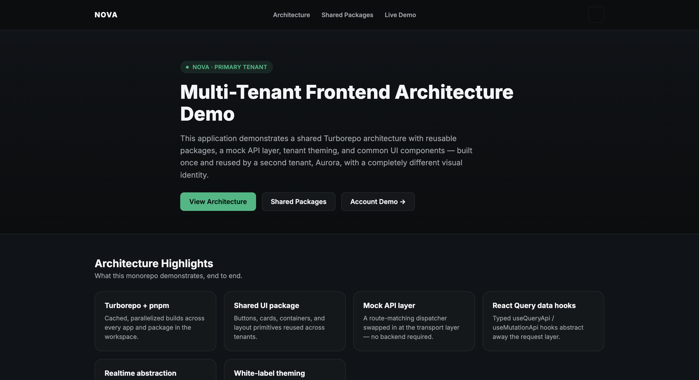
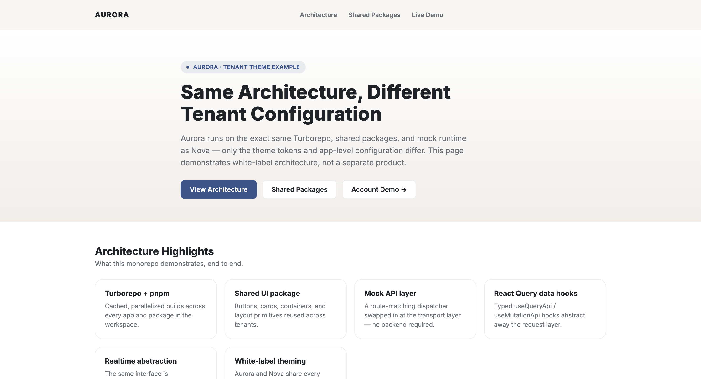
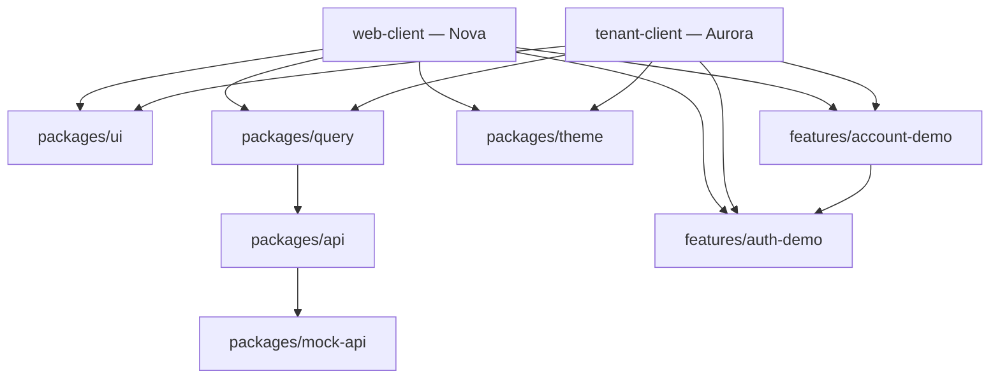

# Multi-Tenant Frontend Monorepo

A React + TypeScript frontend monorepo demonstrating shared architecture across
two independently deployable, white-labeled tenant applications that share one
codebase.

This is an **engineering architecture demonstration, not a recreated product**.
The goal is to show how a shared package graph, mock runtime, tenant theming,
and reusable feature packages work end to end — every route described below
is actually mounted and clickable, not just described in prose.

Everything in this repository runs entirely against a **local mock API layer** —
no backend, database, or third-party account is required to explore it.

**Repository:** [github.com/khoja-kinan/multi-tenant-frontend-monorepo](https://github.com/khoja-kinan/multi-tenant-frontend-monorepo)

## Live Demo

The same shared frontend architecture is deployed as two independent tenant
applications with different visual identities.

| Tenant | Theme | Live Demo |
| --- | --- | --- |
| **Nova** | Graphite / Emerald | [Open Nova](https://multi-tenant-frontend-monorepo-nova.vercel.app/) |
| **Aurora** | Warm Neutral / Cobalt | [Open Aurora](https://multi-tenant-frontend-monorepo-one.vercel.app/) |

Both deployments use the same shared UI, auth, account, query, API, and theme
packages. Tenant-level configuration, theme tokens, and mock/fixture data are
what differ.

### Try the shared account flow

Open `/account` on either tenant and use the demo credentials:

- **Email:** `demo@example.com`
- **Password:** `demo1234`
- **Verification code:** `123456`

No real account or backend is required.

## Tenant Comparison

### Nova



### Aurora



Both applications use the same architecture, shared components, feature
packages, and data-layer implementation. The differences come from
tenant-specific configuration, theme tokens, and mock data/state.

## Overview

This repository is built with Turborepo and pnpm workspaces.

`web-client` (**Nova**) and `tenant-client` (**Aurora**) are two separate
applications that import the same shared packages — UI components, the
API/query layer, theme system, and shared feature packages (`@repo/auth-demo`,
`@repo/account-demo`) — while differing in application configuration, theme
tokens, and tenant-specific mock data/state.

Each tenant exposes two primary routes:

- `/` — an architecture/home page that documents and demonstrates the shared
  package graph live, including a request that travels through
  `useQueryApi` → `@repo/api` → the mock dispatcher.
- `/account` — a shared auth + account experience with a two-step demo login,
  profile management, preferences, session controls, wallet information, and
  activity data. The same feature packages are mounted identically in both
  tenants.

The repository is intentionally scoped to this one story: two tenant
applications sharing a single package graph, differentiated by
configuration, theme, and tenant-specific mock data/state.

## Key Engineering Highlights

- **Turborepo + pnpm workspaces** — cached, parallelized typecheck/build/lint
  across 2 applications and 10 shared packages
- **Two independently deployable tenant applications** sharing a common
  package graph
- **Reusable UI package** (`@repo/ui`) — `AppShell`, `PageContainer`,
  `FeatureCard`, `StatCard`, `SurfaceCard`, `SectionHeader`, `Button`,
  `ThemeBadge`, `FormField`, `Toggle`, and more, used identically by both
  tenant apps
- **API abstraction with a swappable dispatcher** (`@repo/api`) — one request
  layer that can switch between real HTTP transport and the local mock runtime
- **Mock API layer** (`@repo/mock-api`) — route-matching handlers and fixtures
  installed at boot, with zero backend required
- **React Query server-state abstraction** (`@repo/query`) — typed
  `useQueryApi`/`useMutationApi` hooks over a minimal fetch-based `@repo/api`
  transport, used throughout the live demo
- **White-label theming** (`@repo/theme`) — CSS-variable-driven design tokens;
  Nova and Aurora provide different visual identities using the same token
  contract
- **Shared auth + account feature packages** (`@repo/auth-demo`,
  `@repo/account-demo`) — two-step mock authentication, protected routing,
  profile management, preferences, wallet data, and activity

## Repository Structure

```text
apps/
  web-client/       Nova — primary tenant: architecture demo + /account
  tenant-client/    Aurora — same architecture, different tenant theme

packages/
  api/               Minimal fetch-based request layer + mock dispatcher seam
  mock-api/          Mock route handlers, fixtures, demo data
  query/             ApiProvider + useQueryApi/useMutationApi
  ui/                Shared component library (only actively used primitives)
  theme/             ThemeModeProvider, useThemeMode, ThemeToggle
  config/            Shared SCSS design tokens
  eslint-config/     Shared ESLint configuration
  typescript-config/ Shared TypeScript configuration

  features/
    auth-demo/       Session state, mock login, ProtectedRoute
    account-demo/    Profile, preferences, wallet + activity
```

## Applications

| App | Role | Port |
| --- | --- | --- |
| `web-client` (**Nova**) | Primary tenant — graphite/emerald theme, `/` + `/account` | 3000 |
| `tenant-client` (**Aurora**) | Second tenant — warm-neutral/cobalt theme, same routes | 3001 |

Both tenant applications expose the same primary route surface and consume the
same shared architecture.

## Shared Packages

### `@repo/api`

A minimal request layer: a single `sendRequest` function over native `fetch`,
with no HTTP client dependency. Exposes a `setMockDispatcher` seam so
transport can be switched between a real request and the local mock
dispatcher without changing feature-level call sites. Every failure — real or
mocked — surfaces as one `ApiError` shape.

### `@repo/mock-api`

Depends on `@repo/api` and installs a pattern-matching route dispatcher backed
by in-memory fixtures and state.

This allows the full application flow to behave like a backend-driven
application while remaining completely self-contained.

### `@repo/query`

A single `ApiProvider` supplies `{ baseUrl, auth }` to two typed hooks:

- `useQueryApi`
- `useMutationApi`

Feature packages consume these hooks instead of communicating with the
transport layer directly.

### `@repo/ui`

Shared component primitives used by both tenant applications, including:

- `AppShell`
- `PageContainer`
- `SectionHeader`
- `FeatureCard`
- `StatCard`
- `SurfaceCard`
- `Button`
- `ThemeBadge`
- `FormField`
- `Toggle`

The components remain tenant-neutral and receive their visual identity through
the shared theme contract.

### `@repo/theme`

Defines theme token types, theme state, and shared theme utilities.

Each tenant supplies its own token values while consuming the same components.

### `@repo/auth-demo` + `@repo/account-demo`

A reusable auth/account feature pair mounted identically in Nova and Aurora.

The implementation is shared; only tenant configuration, theme tokens, and
mock data/state change.

See [`docs/shared-packages.md`](docs/shared-packages.md) for a more detailed
package breakdown and dependency direction.

## Auth + Account Demo

The `/account` route demonstrates a reusable feature flow rather than a static
UI mockup.

### Authentication

`@repo/auth-demo` provides:

- session state through `useSessionStore`
- two-step mock authentication
- `LoginForm`
- `OtpStep`
- `AuthProvider`
- `ProtectedRoute`

### Account

`@repo/account-demo` provides:

- `AccountSummary`
- `ProfileForm`
- `SecuritySettings`
- `RecentActivity`

The feature uses real `useQueryApi` and `useMutationApi` calls against the
local mock runtime for session, profile, preferences, wallet, and activity
data.

Both packages are mounted with **identical implementation code** in Nova and
Aurora.

The only application-level difference is tenant configuration, theme tokens,
and the mock/fixture data each app runs against.

## Architecture

### Data Flow

The following request path is exercised by the live applications:

```text
Home / Account
      │
      ▼
useQueryApi / useMutationApi
      │
      ▼
@repo/query
      │
      ▼
@repo/api
      │
      ▼
Mock Dispatcher
@repo/mock-api
```

The transport seam allows the mock dispatcher to be replaced by a real HTTP
client without changing feature-level code.

### Package Relationships



See [`docs/architecture.md`](docs/architecture.md) for the full architecture
diagram and per-layer explanation.

## Multi-Tenant Model

Nova and Aurora are separate Vite applications that import the same shared
package graph.

Each application supplies its own `AppConfig` and independent theme token
values.

**Nova**

- dark graphite base
- emerald accent
- primary tenant configuration

**Aurora**

- warm-neutral base
- cobalt accent
- alternate tenant configuration

No shared package hardcodes either tenant's visual identity.

This means the same feature implementation can be reused across tenants while
branding and application-level configuration remain independent.

See
[`docs/multi-tenant-theming.md`](docs/multi-tenant-theming.md)
for the full theming model.

## Mock Runtime

Every application runs against `@repo/mock-api` by default using:

```text
VITE_ENABLE_API_MOCKS=true
```

No backend or database is required.

The tenant home pages fetch live status data through the same query/API stack
used by the account experience.

The `/account` flow exercises mock routes for:

- authentication
- session state
- profile
- preferences
- wallet
- activity

The mock runtime maintains real in-memory state during the session, allowing
mutations and queries to behave like a backend-driven application.

See [`docs/mock-runtime.md`](docs/mock-runtime.md) for implementation details.

## Running Locally

### Requirements

- Node.js
- pnpm

Install dependencies:

```bash
pnpm install
```

Create local environment files:

```bash
cp apps/web-client/.env.example apps/web-client/.env
cp apps/tenant-client/.env.example apps/tenant-client/.env
```

Start the workspace:

```bash
pnpm dev
```

Turborepo starts both applications in parallel:

| Application | Local URL |
| --- | --- |
| Nova | `http://localhost:3000` |
| Aurora | `http://localhost:3001` |

Try `/account` on either Nova or Aurora to explore the shared account flow.

### Run a Single Application

```bash
pnpm --filter web-client dev
```

Other available filters:

```text
tenant-client
```

## Verification

Run the full workspace checks with:

```bash
pnpm typecheck
pnpm build
pnpm lint
```

All commands execute across the workspace through Turborepo with caching.

## Tech Stack

**Frontend**

React 18 · TypeScript · Vite 6 · SCSS Modules

**Architecture**

Turborepo · pnpm workspaces · shared package architecture · multi-tenant
configuration

**State & Data**

Zustand · TanStack Query (React Query) through `@repo/query`

**Infrastructure Abstractions**

Mock API transport with a swappable dispatcher

**Tooling**

ESLint · shared TypeScript configuration · Turborepo build orchestration

## Documentation

Additional technical documentation is available in:

- [`docs/architecture.md`](docs/architecture.md) — architecture and dependency flow
- [`docs/shared-packages.md`](docs/shared-packages.md) — shared package responsibilities
- [`docs/multi-tenant-theming.md`](docs/multi-tenant-theming.md) — tenant configuration and theming
- [`docs/mock-runtime.md`](docs/mock-runtime.md) — local API/runtime implementation

## Portfolio Scope

This repository demonstrates:

- monorepo architecture with **2 applications and 10 shared packages**
- a white-label/multi-tenant frontend pattern with two independently deployable
  applications sharing one package graph
- reusable feature packages consumed identically by multiple tenants
- separation between UI, server-state, and transport layers
- a swappable API implementation (mock dispatcher vs. real HTTP client)
- CSS-variable-driven tenant theming
- a fully self-contained mock runtime that makes the architecture reviewable
  without external infrastructure

It is intentionally not a full consumer product.

The tenant applications expose a deliberately curated feature surface so the
focus remains on **frontend architecture, package boundaries, reuse,
multi-tenant configuration, and infrastructure abstraction** rather than on
reconstructing a finished business application.
