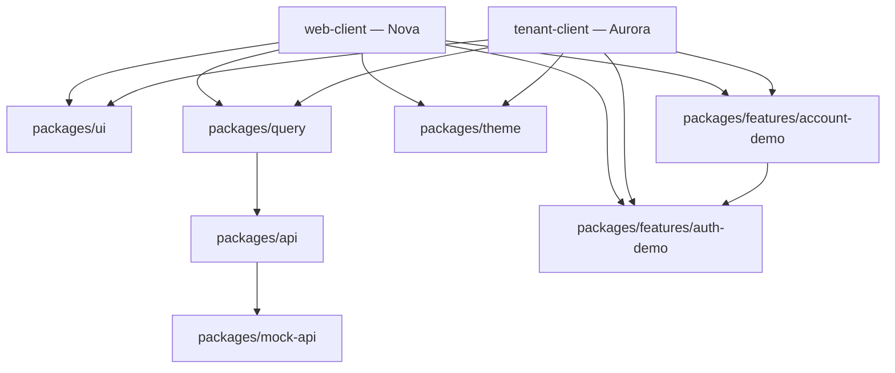

# Architecture

## Workspace layout

This is a Turborepo-managed pnpm workspace (`pnpm-workspace.yaml` includes
`apps/*`, `packages/*`, and `packages/features/*`). `turbo.json` defines the
task graph: `build` depends on `^build` and `^typecheck` (both its own and
its dependencies'), so packages are typechecked and built in the correct
order and results are cached per-task.

```
apps/            2 independently runnable Vite apps (Nova, Aurora)
packages/        10 shared packages (UI, data, config, ...)
packages/features/  2 small shared feature packages (auth-demo, account-demo)
```

## App boundaries

| App | Depends on | Notes |
| --- | --- | --- |
| `web-client` (Nova) | `@repo/ui`, `@repo/theme`, `@repo/query`, `@repo/mock-api`, `@repo/auth-demo`, `@repo/account-demo` | Primary tenant, `/` + `/account` |
| `tenant-client` (Aurora) | Same package set as Nova | Second tenant, same architecture, different theme |

Nova and Aurora are two separate Vite entry points that both import from the
same `@repo/*` packages. Nothing in a shared package branches on which app is
consuming it — differences are expressed entirely through configuration
(theme tokens, `AppConfig`) supplied by each app. This is the same shape a
real multi-brand product would use to add a third tenant without touching
shared code.

Both apps expose the same two routes: `/` (the architecture-demo home page)
and `/account` (the shared `@repo/auth-demo` + `@repo/account-demo`
experience). Both routes are actually mounted and clickable in both apps —
there is no "kept but not rendered" package left in the workspace.

## Server-state flow

```
Home page or /account (web-client or tenant-client)
  → useQueryApi / useMutationApi (@repo/query)
    → @repo/api (single request layer, exposes setMockDispatcher)
      → mock dispatcher (@repo/mock-api), or a real HTTP client when
        VITE_ENABLE_API_MOCKS=false
```

This exact path is exercised live in two places: both home pages call
`useQueryApi` against `/demo/runtime-status` on load and render the result as
a "Mock API status" stat, and the entire `/account` flow — login, OTP verify,
profile load/save, preference toggles, session refresh/logout, wallet
balance, and recent activity — runs through the same hooks against real mock
routes with in-memory state. Feature code never imports `@repo/api`
directly — it goes through `@repo/query`'s hooks, which normalize
loading/error state, caching, and retries in one place. The swap point
between mock and real backend lives entirely inside `@repo/api`'s dispatcher
registration, so nothing above that layer needs to know which mode is active.

## State management

Client state that isn't server-state is split by how many consumers actually
need it. `useSessionStore` (`@repo/auth-demo`) is a small Zustand store,
because the request layer's auth adapter reads it from outside React
(`useSessionStore.getState()` in each app's `QueryProvider`). The active
theme mode (`@repo/theme`'s `ThemeModeProvider`) is a plain React context
instead — nothing reads it outside a component, so a store wasn't needed.
`web-client`'s `ThemeToggle` reads and writes the mode via `useThemeMode()`;
both apps read `useSessionStore` for the request layer's auth-token wiring.

## Auth + account demo

`@repo/auth-demo` owns session state and a two-step mock login: `LoginForm`
(credentials, validated against `@repo/mock-api`'s demo session route)
followed by `OtpStep` (a one-time code, verified against a second mock
route that establishes the session on success). `ProtectedRoute` gates
`/account`'s content behind that session state, and `AuthProvider` hydrates
it once on mount so a page reload behaves the way a real cookie/token check
would.

`@repo/account-demo` builds on top of it: `AccountSummary`, `ProfileForm`,
`SecuritySettings` (notification preferences + session refresh/sign-out), and
`RecentActivity`, each backed by a real `useQueryApi`/`useMutationApi` call.
Both packages are mounted with identical code in Nova and Aurora — this is
the same "shared feature package, tenant supplies only config/theme" pattern
`@repo/ui` demonstrates, just at the feature-package layer instead of the
component layer.

See [`mock-runtime.md`](mock-runtime.md) for how the mock layer is wired up,
[`shared-packages.md`](shared-packages.md) for package-by-package detail, and
[`multi-tenant-theming.md`](multi-tenant-theming.md) for how Nova and Aurora
diverge visually while sharing everything else.

## Diagram


